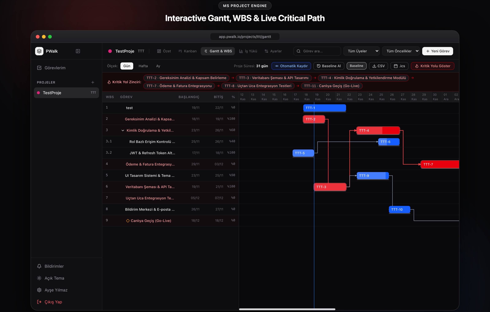
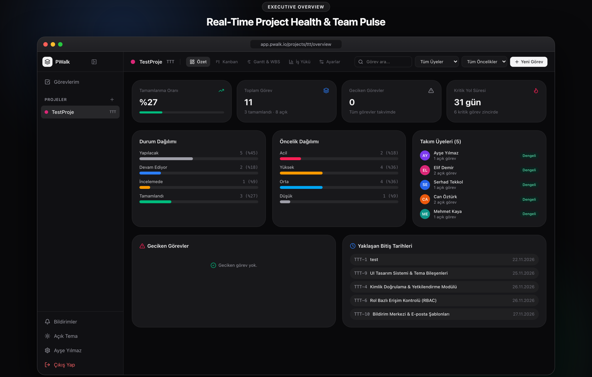
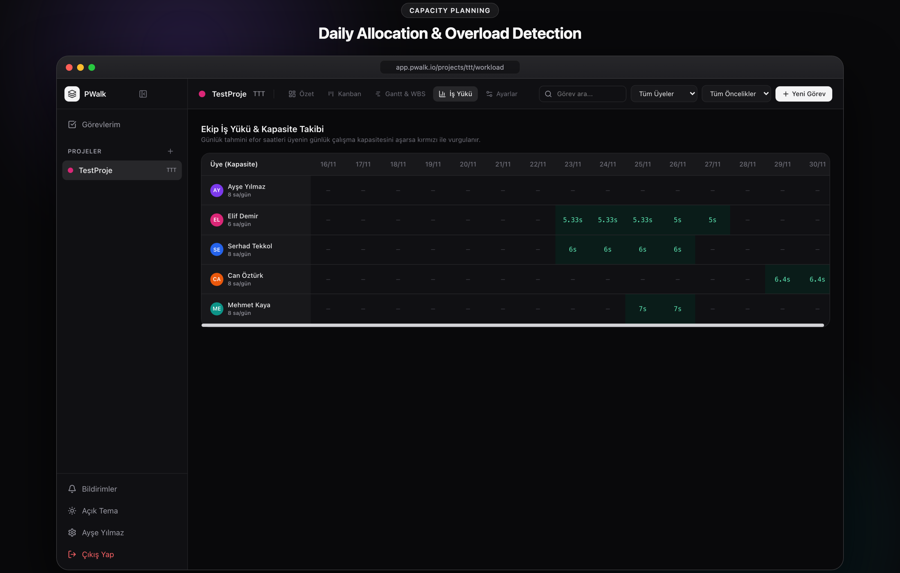

<div align="center">

# PWalk

### Plan with precision. Ship without chaos.

**Modern Kanban flow meets an MS Project–grade Gantt, WBS & Critical Path engine — self-hosted in 60 seconds.**

[](https://www.typescriptlang.org/)
[](https://react.dev/)
[](https://fastify.dev/)
[](https://www.docker.com/)

[Features](#why-pwalk) · [Product Tour](#product-tour) · [Quick Start](#quick-start) · [Tech Stack](#tech-stack)

</div>

---

## Why PWalk?

Most project tools force a compromise: lightweight Kanban boards fall apart on complex timelines, while legacy desktop schedulers feel stuck in 2005. **PWalk** unifies both in a single, fast, self-hosted workspace.

- **Visual Flow, Zero Friction** — Fluid drag-and-drop Kanban with custom columns, WIP limits, tags, and instant Critical Path awareness.
- **Real-Time Critical Path (CPM)** — Drag or resize any bar on the Gantt chart and watch project duration, dependencies, and the driving critical chain recalculate live.
- **Auto-Schedule & Baselines** — Cascade dependent tasks automatically when timelines shift, freeze project baselines, and spot schedule slippage at a glance.
- **Zero-Guesswork Capacity** — Track daily team allocation against individual capacity limits before bottlenecks happen.
- **Instant Alerts Anywhere** — Built-in `@mention` notifications, PWA Web Push, and `ntfy` mobile delivery.

---

## Product Tour








---

## Quick Start

Spin up the full stack (**Web + API + Swagger Docs**) with Docker Compose:

```bash
# 1. Configure environment
cp .env.example .env
npx web-push generate-vapid-keys
```

Update `DATABASE_URL` in `.env` with your SQL Server credentials:
```env
DATABASE_URL="sqlserver://mssql:1433;database=pmam;user=KULLANICI_ADINIZ;password=SIFRENIZ;encrypt=true;trustServerCertificate=true"
```

```bash
# 2. Build and launch
docker compose up -d --build
```

| Service | URL |
| --- | --- |
| **Web App** | `http://127.0.0.1:3600` |
| **Swagger / OpenAPI** | `http://127.0.0.1:3600/docs` |
| **Health Check** | `http://127.0.0.1:3600/api/v1/health` |

> **Cloudflare Tunnel:** `pmam-web` attaches to the external `web` Docker network — point your Public Hostname directly to `http://pmam-web:80`.

---

## Tech Stack

| Layer | Technology |
| --- | --- |
| **Frontend** | React 19, TypeScript, Vite, Tailwind CSS v4, `@dnd-kit` |
| **Backend** | Fastify, Zod, JWT + Refresh Token Rotation, OpenAPI/Swagger |
| **Database** | Microsoft SQL Server + Prisma ORM |
| **Scheduling & Alerts** | Custom CPM / WBS / Workload Engine, Web Push (VAPID), `ntfy` |
| **Deployment** | Multi-stage Dockerfiles, Nginx reverse proxy, Docker Compose |
