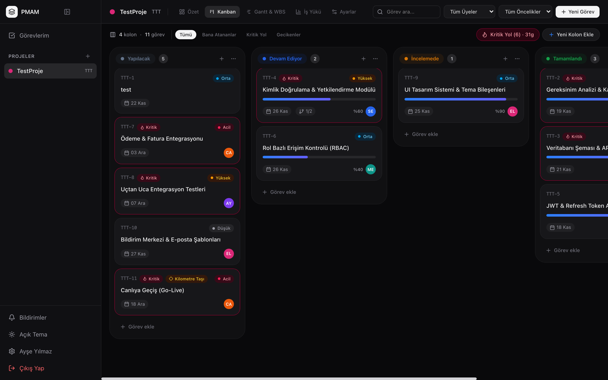

# PWalk — Proje Yönetimi Uygulaması

Kanban Board, MS Project benzeri Gantt/WBS/Kritik Yol/İş Yükü görünümleri, Otomatik Tarih Kaydırma (Auto-Schedule), Baseline karşılaştırması, Web Push + `ntfy` bildirimleri ve mobil uyumlu REST API (`/api/v1` + `/docs` Swagger) içeren çok kullanıcılı proje yönetim uygulaması.

## Ekran Görüntüleri

### Proje Özeti (Dashboard)


### Kanban Panosu


### Gantt, WBS & Kritik Yol (CPM)


### Takım İş Yükü (Workload)


## Öne Çıkan Özellikler

- **Proje Özeti (Dashboard):** Tamamlanma oranı, geciken görevler, kritik yol süresi, durum/öncelik dağılımı ve takım yükü özeti.
- **Modern Kanban Panosu:** Sürükle-bırak görev taşıma, özel kolon ekleme/düzenleme/sıralama, WIP limiti uyarısı, renkli etiketler ve tek tık hızlı filtreler (`Bana Atananlar`, `Kritik Yol`, `Gecikenler`).
- **MS Project Gantt & WBS:** Hiyerarşik WBS ağacı, `FS/SS/FF/SF` bağımlılık okları, takvim boşluklarını hesaba katan canlı **Kritik Yol (CPM)** motoru, **Otomatik Tarih Kaydırma (Auto-Schedule)**, **Baseline** karşılaştırması ve **CSV / `.ics`** dışa aktarım.
- **İş Yükü & Kapasite Planlama:** Görev bazlı `estimatedHours` dağılımı ve kullanıcı bazlı `dailyCapacityHours` aşırı yük tespiti.
- **Bildirimler:** `@mention` yorum bildirimleri, Web Push (PWA) ve `ntfy` entegrasyonu.

## Kurulum ve Docker ile Çalıştırma

1. `.env.example` dosyasını `.env` olarak kopyalayın ve MSSQL + JWT + VAPID bilgilerinizi girin:
   ```bash
   cp .env.example .env
   npx web-push generate-vapid-keys
   ```
   - `DATABASE_URL` içinde mevcut Docker `mssql` sunucunuzun kullanıcı adı ve şifresini yazın:
     `sqlserver://mssql:1433;database=pmam;user=KULLANICI_ADINIZ;password=SIFRENIZ;encrypt=true;trustServerCertificate=true`

2. Container'ları oluşturup ayağa kaldırın:
   ```bash
   docker compose up -d --build
   ```
   - Web arayüzü: `http://127.0.0.1:3600`
   - OpenAPI / Swagger dokümantasyonu: `http://127.0.0.1:3600/docs`
   - Sağlık kontrolü: `http://127.0.0.1:3600/api/v1/health`

## Cloudflare Tunnel (`cloudflared`) Bağlantısı

`pmam-web` servisi mevcut `web` Docker ağına bağlıdır. Cloudflare Zero Trust panelinden tünelinize yeni bir Public Hostname ekleyin:
- **Subdomain:** ör. `pm.alanadiniz.com`
- **Service:** `http://pmam-web:80`
